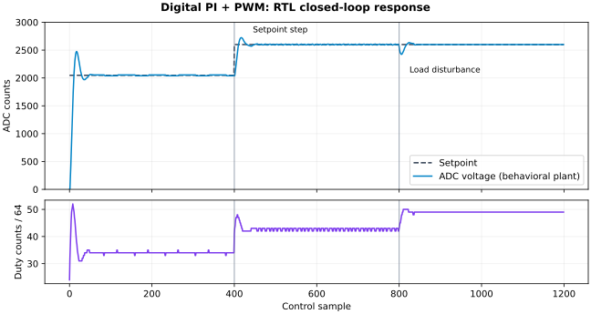

# 可编程数字电源管理控制器：PMIC Digital RTL

[](https://github.com/cydonia0717-crypto/-PMIC-RTL-/actions/workflows/ci.yml)

面向电源管理数字控制的独立 RTL 工程：4 路电源轨时序、Q8.8 定点 PI/PID、互补 PWM/死区、故障保护、I²C 寄存器和 ADC 整帧跨时钟域传输。提供真实 RTL 回归、独立 Python 数学模型、闭环行为仿真、双仿真器和自动化综合检查。

## 核心实现

| 模块 | 实现 |
|---|---|
| 4 路电源轨 | 0→3 顺序上电、3→0 顺序关电；逐轨延迟、power-good 资格、启动超时、使能掩码 |
| 控制环 | PI / PID 可选；系数 Q8.8，积分限幅、输出限幅、条件抗积分饱和、软启动目标值 |
| PWM | 每路互补输出；可编程死区；帧边界原子更新占空比；故障门控 |
| 保护 | 欠压/过压/过流去抖、外部 trip、ADC 样本停止、启动超时；故障锁存和停机清除 |
| I²C | 7 位地址 `0x2D`，开漏 SDA；字节指针、自增、重复 START、ACK/NACK、输入滤波 |
| 配置 | 128 字节影子寄存器；停机校验后整组提交；运行中拒绝提交并保留原配置 |
| CDC / reset | 96 位 ADC 帧的 toggle 请求/应答；两级同步；公共复位、各时钟域同步释放 |
| 可观测性 | I²C 读取故障原因、使能状态和整帧遥测快照；IRQ 掩码 |

顶层：`rtl/pmic_top.sv`。ADC 和功率级是数字接口/行为模型，工程不包含模拟 ADC、误差放大器、功率 MOSFET 或模拟环路签核。

## 一键验收

Ubuntu 24.04 / WSL2：

```bash
sudo apt-get update
sudo apt-get install -y iverilog verilator yosys
make test
make lint
make cross
make synth
```

可通过 `IVERILOG/VVP/VERILATOR/YOSYS` 覆盖工具路径。`build/` 保存镜像、trace 和日志，`reports/` 保存实际执行生成的 JSON 结果。GitHub Actions 执行同样的四项检查。

## 已验证的结果

| 验证 | 结果 |
|---|---|
| PID 位精确模型 | 4,096 组，含持续状态、饱和、积分限幅和导数项 |
| PWM | 85 组占空比/死区组合；无重叠、边界更新和立即 kill |
| CDC | 2,000 帧完整序列，另含中途复位 epoch；异步时钟和反压 |
| 保护模块 | 6 类定向场景，另检查去抖复位、阈值相等和停机清除 |
| 时序模块 | 5 组定向流程；逐轨精确延迟、PG 计数恢复、掩码、逆序关断和超时优先级 |
| 系统 | 7 类场景 × 4 个 I²C 时序种子，共 28 组 |
| 第二仿真器 | Verilator 执行全部 7 类系统场景 |
| 闭环 | 1,200 个控制样本，逐样本核对 PID 结果和行为功率级 |
| RTL / 综合 | Verilator `--Wall` 无警告；Yosys 结构检查无 latch，PID 通用逻辑映射通过 |

完整结果以 `reports/` 为准。尚未进行工艺级 STA、P&R、FPGA 上板、模拟稳定性或真实电源测试，没有报告实际 MHz、面积或效率。

## 闭环行为仿真



目标 ADC 码从 2,048 变为 2,600，然后施加 400 码等效负载扰动。三个稳态窗口的最大误差分别为 9、10、0 码，最后回到 2,600。曲线包含占空比量化和死区造成的有效脉宽变化，来自实际 RTL trace；功率级是一阶整数模型。

[架构与算法](docs/architecture.md) · [完整寄存器映射](docs/register-map.md) · [验证与限制](docs/verification.md) · [代码阅读和讲解](docs/walkthrough.md)

## 工程目录

```text
rtl/       可综合控制器模块
tb/       I²C master、模块和系统测试、闭环功率级模型
tools/    独立 PID 模型、向量生成、回归、第二仿真器、绘图和综合
docs/     架构、寄存器、验收与阅读说明
reports/  实际运行结果
```

## 规范参考

I²C 协议行为参照 [NXP UM10204](https://www.nxp.com/docs/en/user-guide/UM10204.pdf)。实现为原创数字控制练习代码；未复制外部 PMIC 或 PID 开源实现。
