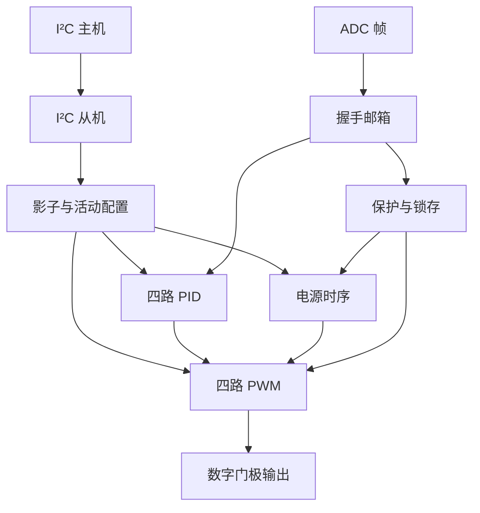

# 架构和算法

## 设计边界与参数

`pmic_top` 有主时钟 `clk` 和 ADC 时钟 `adc_clk`，二者可以异步；`arst_n` 为共同低有效复位。主时钟负责 I²C、寄存器、控制环、PWM、时序和保护，ADC 时钟只负责输入帧握手。

| 参数 | 默认值 | 含义 |
|---|---:|---|
| PWM_PERIOD | 1,024 | 每个 PWM 周期的主时钟拍数，支持 16～65,535 |
| SEQ_DIV | 50,000 | 电源时序 tick 的分频值，至少为 2 |
| STALE_CYCLES | 100,000 | 开启后连续未接受新 ADC 样本的主时钟拍数上限 |
| ADC 帧 | 96 位 | 4 路 ×（12 位电压 + 12 位电流） |

如果主时钟为 50MHz，默认 PWM 数字周期对应约 48.828kHz，时序 tick 为 1ms。这里是参数换算，不是已完成 STA 的工作频率结论。

ADC 帧第 r 路：`[24*r +: 12]` 为电压码，`[24*r+12 +: 12]` 为电流码。电压和电流阈值使用原始 ADC 码，工程不假定参考电压、采样电阻或物理电压/电流单位。

## 定点 PI/PID

位置式离散控制：

`e[k] = target[k] - measured[k]`

`I_candidate = clamp(I[k-1] + Ki * e[k])`

`u_q = Kp * e[k] + I_candidate + Kd * (e[k] - e[k-1])`

`u = clamp(u_q >>> 8, duty_min, duty_max)`

PI 模式关闭导数项。Kp/Ki/Kd 为 signed 16-bit Q8.8，寄存器配置只接受非负系数。误差为 signed 13-bit，差分为 signed 14-bit，乘积为 signed 32-bit，总和为 signed 64-bit。积分存储为 Q8.8，限制在 `±8,388,352`，即 `±32767 × 256`。

输出超上限且误差为正，或低于下限且误差为负时，冻结本次积分更新；其他情况下提交积分候选值。每次完成都保存上一误差。算术右移对负值向负无穷取整，Python 模型采用相同的位精确数学定义。

系数已经包含采样周期：Ki 对应离散积分增量，Kd 对应离散误差差分增益。改变 ADC 样本频率后必须重新评估参数和环路行为。

### 控制流水

| 状态 | 动作 |
|---|---|
| IDLE | 接受 target/measured/coefficients/limits 并锁存 |
| MULT | 并行计算 P、积分增量、D 三个乘积 |
| ACC | 积分限幅，64 位求和 |
| OUTPUT | 输出限幅、条件积分提交、保存前一误差，done |

输入接受后的第 3 个时钟边沿产生 done，即包含接受拍的 4 个边沿。busy 时不接受新样本，ADC 邮箱以全部四路 ready 为接收条件，避免丢样本。

### 软启动

每路使能后，控制目标从 0 起，每个新 ADC 帧增加 `soft_step`，达到配置 target 后保持。step=0 使用目标值直接控制。轨关闭时软目标和 PID 状态清零。

当前样本的 PID 使用上一拍已经保存的软目标，目标斜坡存在一个样本延迟。power-good 按最终 nominal target 的容差判断。

## PWM / 死区

每路 phase 为 0～PERIOD-1。首次启动和每次周期回绕时锁存 duty 和 deadtime；中途写入控制结果不会改变当前帧。

- high：`deadtime <= phase < duty`
- low：`duty + deadtime <= phase < PERIOD`
- 高侧有效拍数：`max(duty-deadtime, 0)`。
- 低侧有效拍数：`max(PERIOD-duty-deadtime, 0)`。

周期起点和高低切换处分别插入死区，所以请求 duty 与实际高侧脉宽有差异，闭环行为模型统计真实 high 输出拍数。`armed` 防止使能瞬间用尚未锁存的旧参数产生输出。

kill 组合门控 high/low；寄存器状态随后复位。正常关轨与公共复位也关闭两个输出。数字边沿无重叠不等价于实际 MOSFET 的开关延迟或驱动器死区签核。

## 电源时序

状态：OFF、DELAY、WAIT_GOOD、ON、SHUTDOWN、FAULT。

RUN=1 后按 0→3 遍历 mask。每路先等待配置 delay，再置 power_enable，等待电压落入 `target ± tolerance` 的范围连续 3 个 sequencer tick，然后设置 qualified 并处理下一路。屏蔽轨跳过。全部完成后 ready=1。

delay 是进入 DELAY 后等待的 tick 计数；即使 delay=0，也需要下一次状态机 tick 才置使能。power-good 资格统计时序 tick，不是 ADC 帧数。

WAIT_GOOD 超过配置 timeout，锁存该轨超时原因并关闭全部轨。到达 deadline 的当拍 timeout 优先。RUN=0 正常停机时按 3→0，每 tick 关一轨。

任一保护/超时故障使系统进入 FAULT，并全关所有轨，避免依赖轨继续工作。FAULT 没有自动重试；RUN=0 后软件写 W1C 掩码，再显式启动。

## 保护

电压高于 OV、采样电流高于 OC，或已经 qualified 的轨低于 UV 时，连续 3 个 ADC 样本异常才锁存。阈值相等不触发；恢复正常立即清对应去抖计数。启动尚未 qualified 时禁止 UV 检测，由 startup timeout 与 stale 防护负责。

外部 trip 经两级主时钟同步后参与直接 PWM kill，并锁存原因。外部输入到数字关断包含同步延迟，工程不包含模拟比较器和专用异步关断电路。

每个开启轨记录距上次新 ADC 帧的主时钟计数。无样本达到 STALE_CYCLES 锁存 stale 原因。关轨清去抖和时间计数，但保留原因锁存；清除只在关闭状态且 software RUN=0 时有效。

故障原因位：OV=0、UV=1、OC=2、startup timeout=3、ADC stale=4、external trip=5。IRQ 为有掩码的故障或 config_error。

## I²C 和原子配置

I²C 7 位地址 0x2D。SCL/SDA 都先经过两级同步，再经过 3 个连续一致样本的数字滤波，控制器只用主时钟，不把 SCL 当作 RTL 时钟。

接收序列为 address+W、pointer、data bytes；写数据每个完整字节才发布，STOP/新 START 丢弃未完成字节。读序列支持重复 START、address+R、主机 ACK 连读与最后 NACK。pointer 每个字节自增并按 8 位回绕。

SDA 输出是拉低使能，集成层必须使用开漏/三态和上拉。没有 clock stretching、10-bit 地址、SMBus PEC、总线恢复脉冲发生器。要求系统时钟至少是 SCL 的 20 倍，并满足输入滤波、输出应答的低/高时间；测试使用 50MHz 主时钟、SCL 高低分别至少 80 拍。

影子参数允许随时编辑。活动参数只在 RUN=0 且时序 OFF 时整组校验/提交；否则置 config_error、保留当前活动配置，正在运行的轨继续工作。合法提交会清 config_error。软件字节写入和 PWM 帧边界更新分别解决配置整体性与波形整体性。

在匹配读地址时，对 ADC 96 位帧、使能、故障原因和时序状态进行一次快照；整个读事务使用该快照，避免低/高字节来自不同采样时刻。

## ADC CDC 与复位

源域 ready 时接受完整 96 位帧，锁存 payload 并翻转 request。目标域通过两级同步观察 toggle，在 PID 可接受时一次性采样保持中的 payload，然后回传 ack。源域在 ack 两级同步返回前不改 payload。目标域还阻止在 dst_valid 输出拍再次接收，确保消费者不会被连续的脉冲覆盖。

这是握手保持的数据总线，不能替换成各位独立的两级同步。它保证数字协议下的完整性；物理实现需要识别同步寄存器，并给保持总线设合适的路径/偏斜约束。

公共 arst_n 异步拉低每域的释放链，每域随后通过两个本地时钟边沿同步释放。邮箱内部状态同步复位。仅支持共同复位两个域；不支持任一域独立复位后继续沿用旧握手 epoch。公共复位丢弃在途帧，上游应重新开始发送。
